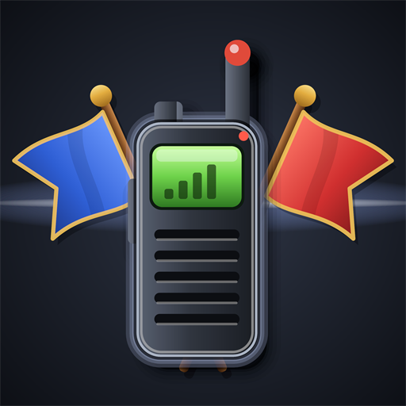

# BGComs - Battle Ground Communications

Battleground callouts in one gesture. Middle-click a base on the battlefield map, drag towards a call, release: "3 inc GM" goes out in battleground chat. Everyone reads it, with or without the addon.

Made for **World of Warcraft: Forever**.

- [Features](FEATURES.md): every call, option and command, explained.
- [Changelog](CHANGELOG.md)

## Install

Install it from [CurseForge](https://www.curseforge.com/projects/1823879) (Forever flavor), or by hand:

1. Copy the `BGComs` folder into `World of Warcraft\_forever_\Interface\AddOns`.
2. Restart the game.

## Quick start

1. In a battleground, open the battlefield map with **Shift-M**. BGComs opens it for you when you enter one.
2. **Middle-click** near a base and keep the button held: a wheel opens with the base's code in its centre.
3. **Drag** towards a call. For INC and SPOTTED, drag further for more enemies (1 to 5+).
4. **Release**: the callout goes to battleground chat. Release in the centre to cancel.

| Direction | Call | Sends |
|---|---|---|
| Up | INC, with a count | `3 inc GM` |
| Up-right | SPOTTED, with a count | `2 spotted GM` |
| Up-left | HELP | `help GM` |
| Down-left | OMW (on my way) | `omw GM` |
| Down | CLEAR | `GM clear` |
| Down-right | EFC (flag battlegrounds) | `EFC GM` |

Try it outside battlegrounds first: `/bgc test ab` draws Arathi Basin on your Shift-M map and shows the callouts in your chat only.

## Commands

| Command | What it does |
|---|---|
| `/bgc` | Opens the options (also in Options > AddOns > BGComs and in the addon compartment) |
| `/bgc help` | Lists the commands |
| `/bgc test ab` | Test mode anywhere, with Arathi Basin's map (also `wsg`, `av`, `dsi`, `grid`). Add `say` to really send with `/s`; `/bgc test off` stops it |
| `/bgc place CODE` | Your next click on the map puts the place CODE there (out of combat); `/bgc forget CODE` undoes it |
| `/bgc nodes` | Shows or hides the place codes on the map |
| `/bgc mod alt` | Alt + middle-click instead of a plain middle-click (`ctrl`, `shift`, `none`) |
| `/bgc perf` | Measures BGComs' cost per frame |
| `/bgc debug` | Saves BGComs' state into its saved variables, for bug reports |

## Good to know

- **Callouts are plain text** in battleground chat, sent as you: your teammates need no addon. During a match, the game doesn't let addons send chat on their own, so the click runs a secure macro, chosen by a secure snippet. That works in combat.
- **The battlefield map is the click area.** If it is zoomed, panned or opened during combat, a warning says the place may be off until the fight ends.
- **Leaving a battleground:** if the map was closed before, it won't open by itself outside battlegrounds, but it stays on screen until you press Shift-M. Closing Blizzard's map from an addon can cause errors in it.
- **Places:** Arathi Basin, Alterac Valley and Darkspear Islands use the map's own points. Warsong Gulch uses built-in positions. `/bgc place` adjusts any of them.

## Reporting a bug

Open an issue, or comment on the CurseForge page, with what you did, what you expected, and any error message (BugSack shows them). `/bgc debug`, then `/reload`, saves what BGComs saw into `WTF\Account\<account>\SavedVariables\BGComs.lua`.

## Credits

By **Malven31**, made with Claude (Anthropic). The icon is the addon's own (`scripts/make-icon.ps1` draws it).

## Licence

MIT, see [LICENSE](LICENSE).

## Releasing

Releases are packaged and uploaded to CurseForge automatically when a version tag is pushed. The GitHub workflow `.github/workflows/release.yml` runs the [BigWigs packager](https://github.com/BigWigsMods/packager), following `.pkgmeta`.

1. Add a section for the new version at the top of `CHANGELOG.md`, for example `## 1.0.1 (2026-12-01)`, summarising for players what is new (`### New`), fixed (`### Fixed`) and changed (`### Changed`). Commit it. This section, and only this one, becomes the changelog of the file on CurseForge (website and app). A release without it is refused.
2. Run `powershell -File scripts/release.ps1 -Version 1.0.1`. It sets the version in the TOC, commits, and tags.
3. Push the branch and the tag, or add `-Push` to the command.

A tag containing `beta` or `alpha` (for example `1.1.0-beta1`) becomes a beta or alpha file on CurseForge, and any other tag a release. Every push to `main` is a dry run, and so is a run started by hand from the Actions tab: it checks that CurseForge accepts the token, builds the zip, checks its contents and attaches it to the run, without uploading anything. The TOC must have its `## X-Curse-Project-ID:` line before a tag can upload.

To build a zip locally instead, run `powershell -File scripts/package.ps1`. It writes `dist/BGComs-<version>.zip`, with `BGComs` at the root of the archive and the licence inside it, like the workflow's zip.

Pictures: `scripts/make-icon.ps1` draws the icon (`-Out curseforge/logo.png -Size 512` and `-Out BGComs/media/icon.tga -Size 64`), `scripts/make-media.ps1` the wheel's soft line and glow textures, and `scripts/make-gallery.ps1` the gallery illustrations.
