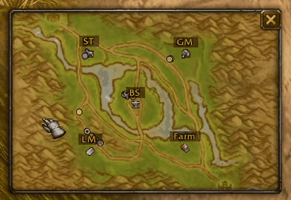

# BGComs - Battle Ground Communications

<!-- Download badge for CurseForge project 1823879, served by shields.io. -->

**Call incomings in one gesture.** Nobody types "3 inc farm" in the middle of a fight. With BGComs you don't type either: middle-click a base on the battlefield map, drag towards a call, release. The callout goes out in battleground chat, and your whole team reads it, with or without the addon.

Made for **World of Warcraft: Forever**.

## How it works

1. Open the battlefield map (**Shift-M**). BGComs opens it for you when you enter a battleground.
2. **Middle-click** near a base and keep the button held: a wheel opens, with the base's code in its centre.
3. **Drag** towards a call. For incomings and spotted enemies, drag further for more: 1, 2, 3, 4, 5, 5+.
4. **Release.** Battleground chat gets "3 inc GM". Release in the centre to cancel.

| Direction | Call | Sends |
|---|---|---|
| Up | Incoming, with a count | 3 inc GM |
| Up-right | Enemies spotted, with a count | 2 spotted GM |
| Up-left | Help | help GM |
| Down-left | On my way | omw GM |
| Down | Clear | GM clear |
| Down-right | Enemy flag carrier (flag battlegrounds) | EFC GM |

## What it does

- **Works in combat**, when callouts matter most.
- **Everyone reads it:** the callout is plain text in battleground chat, sent as you. Your teammates need no addon.
- **Knows the battlegrounds:** Arathi Basin's bases, Warsong Gulch's bases, ramps, tunnels and graveyards ("our" and "their" follow your faction), Alterac Valley's towers, bunkers, graveyards and mines, and Darkspear Islands' bases and flag. Their codes are drawn on the map, and `/bgc place` moves them or adds your own.
- **Your words:** change any of the six messages in the options, or switch a call off.
- **Opens the battlefield map** when you enter a battleground.
- **Light:** nothing runs outside battlegrounds, and `/bgc perf` measures what it costs inside.
- **Try it anywhere first:** `/bgc test ab` draws Arathi Basin on your map, and the callouts show in your chat only.

## Commands

- **/bgc**: options (also in Options > AddOns > BGComs and in the addon compartment).
- **/bgc help**: all commands.
- **/bgc test ab**: test mode (`/bgc test off` to stop).
- **/bgc place CODE**: put a place where you click next on the map.

## Good to know

- The battlefield map is where you click. If you zoom or drag it during a fight, a warning says the place may be off until the fight ends.
- After a battleground, the map stays open until you press Shift-M if it was closed before. BGComs doesn't close Blizzard's map itself, because doing that from an addon can cause errors in it.
- During a match, the game doesn't let addons send chat on their own. The click runs a secure macro instead, so it counts as yours, like any macro you press.

## Credits

By **Malven31**, made with Claude (Anthropic).

Licence: MIT.

## Feedback

Report bugs and suggest features in the comments on this page, or on GitHub. For a bug, say what you did and what you expected, and paste any error message (BugSack shows them).

Source code and issue tracker: [github.com/Malven31/battle-ground-communications](https://github.com/Malven31/battle-ground-communications)
